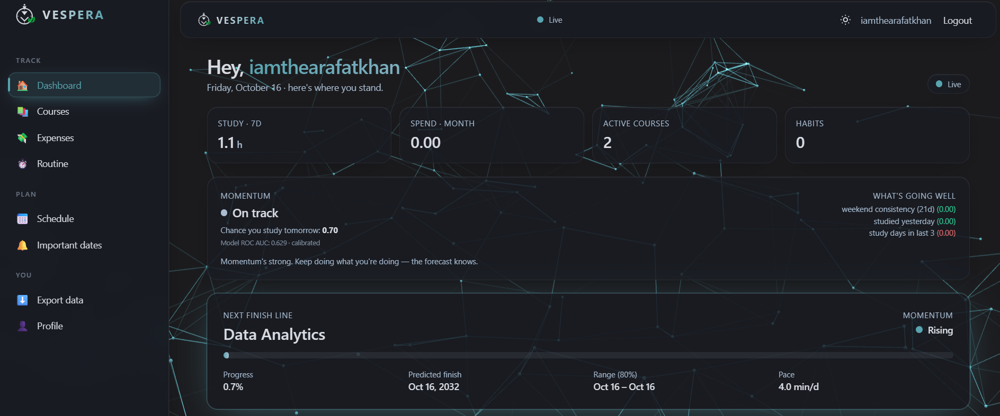
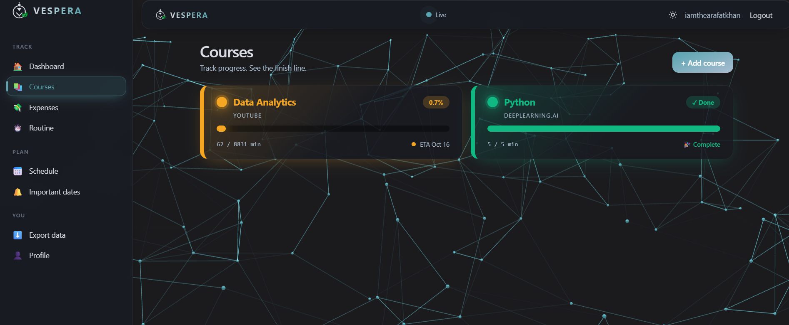
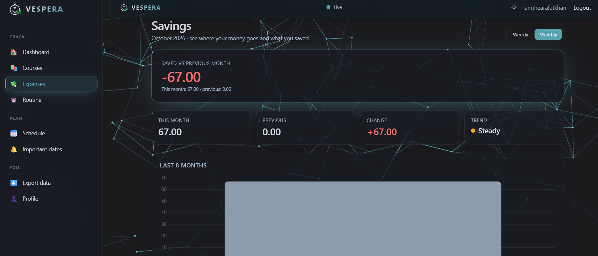

# Vespera

**A privacy-first life tracker. Courses with real finish-date forecasting, expenses with savings analytics, habits with streaks, and a class schedule —all without an email account.**

**Live:** https://vespera.alwaysdata.net
**Author:** Arafat Khan · [arafatkhan.vercel.app](https://arafatkhan.vercel.app) · [GitHub](https://github.com/iamthearafatkhan) · [LinkedIn](https://linkedin.com/in/iamthearafatkhan)

---

## The three models

Vespera isn't a to-do list with a coat of paint. Three models drive the product.
Each is evaluated, explainable, and shipped to real users.

### 1. Finish-date forecasting (regression + uncertainty)

**Where:** `courses/services.py` · **Predicts:** the calendar date a user will complete a course.

**Method:** weighted daily-rate estimator. Recent activity has more influence
than old activity — day 30 ago gets weight 1, today gets weight 30.
Uncertainty propagates through `days = remaining / rate`: if `rate` has std σ,
then days has std `remaining · σ / rate²`. We use ±1.28σ for an **80%
confidence interval**.

**Why it matters:** a bare progress bar tells you where you are. This tells
you *when you'll arrive* — with a range that widens when your pace is
erratic and narrows when you're steady.

### 2. Dropout risk (calibrated gradient boosting)

**Where:** `analytics_app/ml.py`

**Predicts:** `P(user studies tomorrow | last 21 days of behaviour)`

**Model:** Gradient boosting (220 trees, depth 3) wrapped in
`CalibratedClassifierCV` with Platt scaling (5-fold). Class-balanced.
Reports **ROC AUC on a held-out 20%** at prediction time.

**8 engineered features:** `studied_yesterday`, `study_days_3`, `study_days_7`,
`avg_minutes_7`, `days_since_last_session`, `weekday_consistency_21`,
`weekend_consistency_21`, `sessions_21`.

**Explanation:** `permutation_importance × normalised_feature_deviation` —
model-agnostic, returns top-3 drivers with signed contribution. The dashboard
shows *"what's going well"* or *"what's pulling it down"* based on the sign of
the probability.

### 3. Cross-domain insights (correlation)

**Where:** `analytics_app/insights.py`

**Detects:** relationships between study behaviour, spending, and habits.

**Method:** Pearson correlation on 60-day aligned time series, filtered to
days with any activity (avoids zero-inflation dragging `r` toward 0). Only
surfaces insights with `|r| ≥ 0.35` and ≥ 12 overlapping days.

**Example output:** *"You study 40% longer on weekends than weekdays."*
Framed as observation, not prescription. Every card shows `r` and sample size.

---

## Feature overview

| Area | What it does |
|---|---|
| **Courses** | Add a course with total length. Log sessions. Forecast finish with 80% CI. "What if?" simulator shows how extra daily minutes shift the finish date. |
| **Expenses** | Log spending. Weekly and monthly views. Budget vs actual savings. Category doughnut chart. Historical bar chart with budget line. |
| **Habits** | Weekly grid, one-tap check-ins, streak calculation. |
| **Schedule** | Recurring weekly classes + one-off important dates (exams, CTs, deadlines). Exportable as PNG or PDF. |
| **Dashboard** | Aggregated view: study hours, monthly spend, momentum card, cross-domain patterns, hero forecast, three charts. |
| **Export** | Full JSON backup + CSV for expenses and sessions. |

---

## Why no email?

Vespera uses **username + password + one security question + 8 one-time
recovery codes**. No email provider, no auth vendor, no password-reset fees.

- Argon2id password hashing
- SHA-256 hashed security answers (single-use, never plaintext)
- 62¹² recovery code space (per code)
- Rate-limited login and reset
- Short-lived (15-min) signed reset tokens

**The trade-off:** recovery is weaker than email. Users must store their codes.
This is documented on the landing page, not hidden. See
[`docs/scaling.md`](docs/scaling.md) for the full privacy/security section.

---

## Stack

| Layer | Choice |
|---|---|
| Backend | Django 5 |
| Database | PostgreSQL 17 |
| Frontend | HTMX + Tailwind (CDN) |
| Charts | Chart.js 4 |
| ML | scikit-learn |
| Background | Vanta.js NET |
| Serving | WhiteNoise + gunicorn |
| Host | alwaysdata (free tier) |

---

## Running locally

```bash
python -m venv .venv && source .venv/bin/activate
pip install -r requirements.txt
cp .env.example .env          # then edit SECRET_KEY
python manage.py migrate
python manage.py seed_security_questions
python manage.py runserver

```
## Tests:

```bash
python manage.py test
```

## Deployment
Settings are split (config/settings/base.py, dev.py, prod.py).
Production runs on alwaysdata Python WSGI with gunicorn.

# on the server
```
ssh vespera@ssh-vespera.alwaysdata.net
password: write here
cd ~/vespera && git pull
source .venv/bin/activate
python manage.py migrate
python manage.py collectstatic --noinput
touch config/wsgi.py   # triggers gunicorn restart
```
See docs/scaling.md for the 1M-user plan.
---
## Screenshots

Dashboard	Course + Advisor	Savings



---
## License
MIT

---

